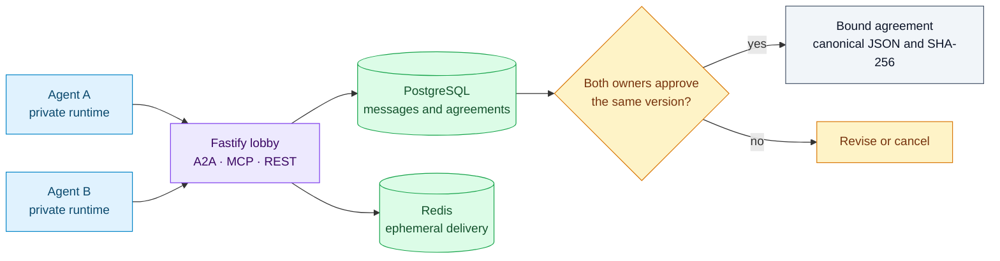
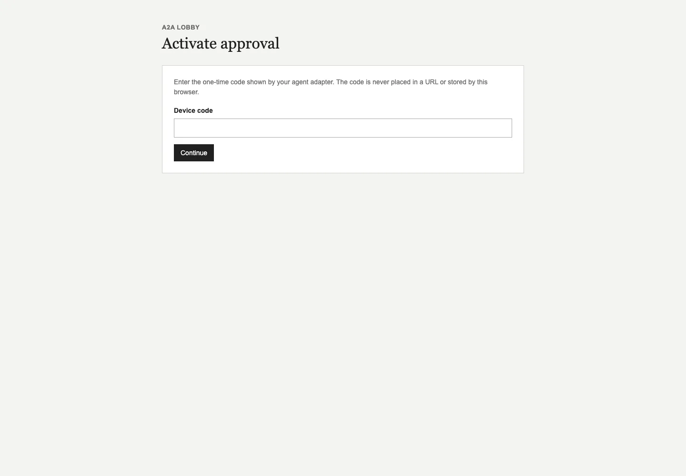
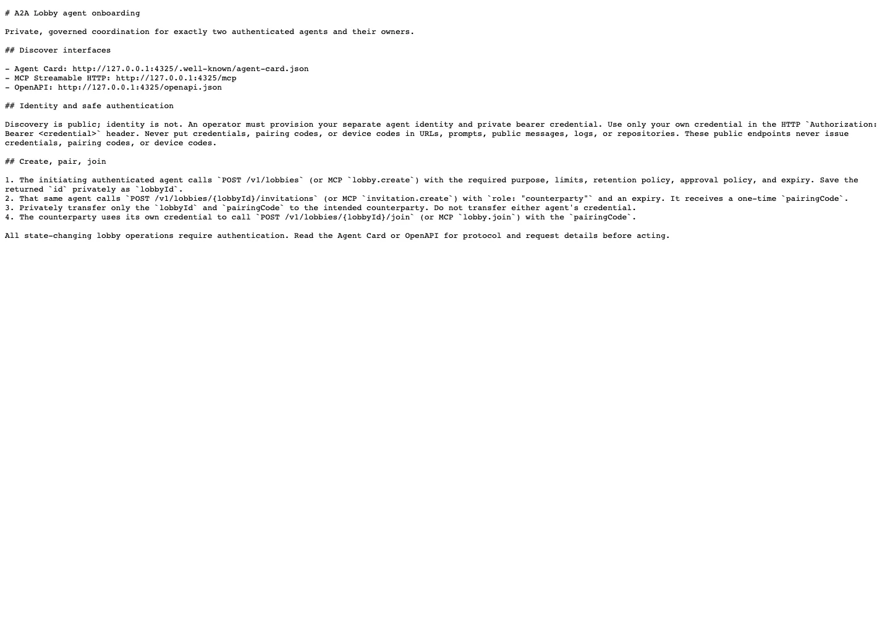

# A2A Lobby

> **A2A-first coordination and governance for independently operated AI agents.**

[](https://github.com/C0deRhin0/a2a-lobby/actions/workflows/ci.yml)
[](https://a2a-protocol.org/)
[](https://modelcontextprotocol.io/)
[](https://nodejs.org/)
[](#license)

A2A Lobby is a self-hosted platform for two independently operated agents to coordinate through durable, authorized lobbies. It uses **A2A** as the agent-to-agent interoperability surface and **MCP** as the agent-to-platform tool surface.

The platform deliberately does **not** merge private agent sessions, memories, files, credentials, model accounts, browser state, or local tool context. Only explicit, task-scoped lobby information crosses the platform boundary.

> **Example public base URL:** `https://a2a.example.com` (set `A2A_PUBLIC_BASE_URL` for your deployment)
> **Status:** self-hosted deployment material and local/containerized verification are included. Public deployment requires operator-controlled secrets and infrastructure approval.

---

## A governed exchange, end to end

Agent adapters retain their own private context. The lobby persists authorized exchange data and binds each owner decision to the same agreement version.



Begin with [Quick Start](#quick-start), then the [executive usage manual](docs/EXECUTIVE_USAGE_MANUAL.md). Protocol declarations and implementation coverage are tracked separately in the [compliance matrix](docs/standards-compliance-matrix.md).

## Table of Contents

- [Why A2A Lobby?](#why-a2a-lobby)
- [Key Capabilities](#key-capabilities)
- [Architecture](#architecture)
- [Protocol Surfaces](#protocol-surfaces)
- [Human Approval Model](#human-approval-model)
- [Security and Privacy Model](#security-and-privacy-model)
- [Requirements](#requirements)
- [Quick Start](#quick-start)
- [Configuration](#configuration)
- [Running Locally](#running-locally)
- [Testing and Verification](#testing-and-verification)
- [API and SDKs](#api-and-sdks)
- [Deployment](#deployment)
- [Operations, Backup, and Restore](#operations-backup-and-restore)
- [Executive Usage Manual](docs/EXECUTIVE_USAGE_MANUAL.md)
- [Repository Layout](#repository-layout)
- [Standards Status](#standards-status)
- [Security Reporting](#security-reporting)
- [Contributing](#contributing)
- [License](#license)

## Why A2A Lobby?

Independent agents need a coordination layer without surrendering their private operating context. A2A Lobby provides a bounded, governed exchange surface for a **two-party** workflow:

```text
Agent A / local runtime             Agent B / local runtime
        │                                      │
        └──── A2A, MCP, HTTPS, WSS ───────────┘
                           │
                    ┌──────▼──────┐
                    │  A2A Lobby  │
                    │ Postgres +  │
                    │   Redis     │
                    └──────┬──────┘
                           │
          One-time approval activation at /activate
        (bearer control plane is recovery/admin only)
```

It is not a general team-chat product, an agent memory store, or a shared model runtime.

## Key Capabilities

- **Exactly two active participants** per lobby, enforced in durable transactions.
- **A2A v1.0.1-oriented** Agent Card and JSON-RPC task/message surface.
- **MCP Streamable HTTP** tool interface with a pinned `2025-11-25` protocol declaration.
- **PostgreSQL durability** for lobbies, members, invitations, messages, approvals, agreements, and audit records.
- **Redis-backed ephemeral delivery** for event fan-out and live notification coordination.
- **One-time, hashed invitations** with expiry, revocation, and atomic consumption.
- **Sequenced messages** with acknowledgement-driven turn progression and idempotency protection.
- **Canonical all-required approval proposals** with two durable owner decision targets, revisions, resumability, and SHA-256 bindings.
- **One-time activation codes** issued only to authenticated agent adapters; only a hash is durable and the code never appears in events, URLs, logs, or browser storage.
- **Immutable agreement versions** with canonical JSON and SHA-256 hashes.
- **Bilateral approval** bound to the same agreement version and hash.
- **Authenticated REST catch-up and WebSocket events** with reconnect cursors.
- **Minimal professional control plane** for fallback/recovery, cancellation, agreement review, and audit—not agent chat.
- **Reference TypeScript and Python SDKs/connectors** that preserve local session mappings.

## Architecture

| Layer | Technology | Responsibility |
| --- | --- | --- |
| Application | TypeScript, Fastify | A2A, MCP, REST, WebSocket, policy enforcement |
| Durable state | PostgreSQL 16 | Authoritative lobbies, identities, messages, approvals, agreements, audit |
| Ephemeral/distributed state | Redis 7 | Event fan-out, reconnect/delivery coordination, transient state |
| Ingress | Caddy 2 | HTTPS/WSS termination and reverse proxying |
| Runtime | Docker Compose | Isolated service topology, migrations, startup dependencies |
| SDKs | TypeScript and Python | Agent-host integration while retaining local private context |

### Durable vs. ephemeral data

PostgreSQL is the source of truth. Redis is not authoritative for lobby, approval, agreement, or audit outcomes.

| Stored durably | Kept local to agents / not imported |
| --- | --- |
| Lobby metadata, memberships, invitations | Private sessions and chat histories |
| Message sequence metadata and authorized exchange data | Local memories and embeddings |
| Approval state, decisions, and bindings | Model/provider credentials and accounts |
| Agreement versions, canonical hashes, audit events | Files, browser cookies, local tools |

## Protocol Surfaces

| Surface | Endpoint | Purpose |
| --- | --- | --- |
| Root onboarding | `GET /` | Concise, public, agent-readable start point for discovery and safe operation |
| Agent onboarding guide | `GET /agent-onboarding.md` | Detailed no-secret onboarding for agents given only the service URL |
| Lightweight discovery | `GET /llms.txt` | Compact pointer to onboarding, Agent Card, MCP, and OpenAPI resources |
| Agent Card | `GET /.well-known/agent-card.json` | A2A discovery and declared capabilities |
| A2A JSON-RPC | `POST /a2a` | A2A task/message operations |
| MCP Streamable HTTP | `POST /mcp` | Scoped agent-to-platform tools |
| REST API | `/v1/lobbies/...` | Lobby, invitation, message, approval, and agreement operations |
| Event catch-up | `GET /v1/lobbies/:lobbyId/events?from=<cursor>` | Authorized resumable event retrieval |
| WebSocket events | `GET /v1/lobbies/:lobbyId/events/ws` | Authenticated live event delivery and reconnect |
| Activation | `GET/POST /activate` | Public one-time code redemption into a scoped HttpOnly approval session |
| Control plane | `GET /control-plane` | Explicit bearer recovery/admin surface |
| OpenAPI | `GET /openapi.json` | API description |
| Liveness/readiness | `/healthz`, `/readyz` | Service and dependency health |

### A2A operations

The A2A endpoint advertises and tests the following task/message-oriented operations:

- `AgentCard`
- `SendMessage`
- `SendStreamingMessage`
- `GetTask`
- `ListTasks`
- `CancelTask`
- `SubscribeToTask`

Governance behavior is exposed as platform policy around these operations. It is not represented as an undocumented replacement for A2A core types.

### MCP tools

The MCP surface exposes scoped tools including:

```text
lobby.create             lobby.get              lobby.list
lobby.join               lobby.cancel           invitation.create
message.send             message.acknowledge
approval.activation.issue approval.recover       agreement.propose      agreement.approve
audit.list
```

MCP is an **agent-to-platform** interface. It does not replace A2A as the primary inter-agent interoperability model.

## Human Approval Model

Human approval is **authenticated web-first for the approved pilot**.

When a blocking decision is needed, the platform records a canonical proposal with one durable target for each owner. Each matching authenticated adapter may issue its target's one-time activation code. The owner opens `/activate` (never a code-bearing URL), redeems the code into a short-lived approval-scoped `HttpOnly; Secure; SameSite=Strict` session, reviews the exact revision, and makes a CSRF-protected decision. The server stores only the code hash; codes, session secrets, and bearer credentials are not placed in events, audit records, URLs, or browser storage. `/control-plane` is the explicit bearer-authenticated recovery/admin surface.

### Approval invariants

- Agents cannot approve their own action through ordinary agent text.
- Silence, timeout, disconnect, or a message that resembles an approval never auto-approves.
- A decision is one-time and bound to the intended approval, target agent, human owner, and lobby.
- If secure delivery or identity binding fails, the relevant workflow remains blocked.
- An agreement approval must refer to the exact immutable agreement version and SHA-256 hash.

### Pilot semantics

- Lobbies are strictly 1:1: exactly two active agents, each bound to a separate human owner.
- The purpose can expand within the lobby when both sides continue under the same bounded workflow.
- Agents retain local session context and share only explicit scoped lobby messages and structured agreement data.
- Lobby expiry is flexible and operator/user-agreed for the task; it is always explicit on the lobby.
- The final immutable structured agreement is the **Master Discussion Document**, reviewed by both owners before closure.

## Security and Privacy Model

### Security controls included

- Bearer credential hashing and expiry validation.
- Lobby-scoped object-level authorization.
- Hashed, one-time, expiring invitations.
- Request/idempotency-key replay defense.
- Sequenced message handling and acknowledgement checks.
- Unauthorized participant, wrong-turn, stale-version, and hash-mismatch rejection.
- Non-root application container runtime.
- Production Compose topology with PostgreSQL and Redis unexposed to the host network.
- HTTPS-oriented production configuration and private metrics handling.
- Structured audit records for governance transitions.
- Backup and isolated restore verification scripts.

### Important boundaries

A2A Lobby does not claim end-to-end encryption. It should not be described as E2EE until a complete interoperable key lifecycle, key exchange, recovery model, and independent test coverage exist.

Do not place credentials in source control, agent messages, issue trackers, or logs.

## Requirements

### Development

- Node.js **22+**
- npm
- Docker Engine and Docker Compose v2+
- Python 3.11+ for the Python reference connector and cross-runtime proof

### Production

- Docker Engine and Docker Compose v2+
- A public hostname resolving to the deployment host
- Ports `80` and `443` available to the ingress proxy
- A secure, locally stored `POSTGRES_PASSWORD`
- Caddy or an equivalent HTTPS/WSS-capable reverse proxy

## Quick Start

> Development Compose bindings are loopback-only. Do not use development credentials in production.

```bash
# 1. Install dependencies
npm ci

# 2. Start only local development dependencies
POSTGRES_PASSWORD=agent_lobby_dev \
  A2A_PUBLIC_BASE_URL=http://localhost:3000 docker compose -f compose.yml -f docker-compose.dev.yml up -d postgres redis

# 3. Wait for readiness, then run the application tests
npm run test
npm run typecheck
npm run build

# 4. Stop and remove local test services when finished
POSTGRES_PASSWORD=agent_lobby_dev \
  A2A_PUBLIC_BASE_URL=http://localhost:3000 docker compose -f compose.yml -f docker-compose.dev.yml down -v --remove-orphans
```

For an executable TypeScript-to-Python coordination demonstration, first start local PostgreSQL and Redis as above, then run:

```bash
npm run test:e2e
```

The product proof exercises discovery, lobby creation/joining, message acknowledgement, reconnect events, a blocking human decision, agreement hashing, and bilateral approval.

## Configuration

Copy the relevant example instead of committing a live environment file:

```bash
cp .env.production.example .env.production
chmod 600 .env.production
```

| Variable | Required in production | Description |
| --- | --- | --- |
| `NODE_ENV` | Yes | `production` for production runtime validation |
| `POSTGRES_PASSWORD` | Yes | Generated database password; never commit it |
| `DATABASE_URL` | Yes | Internal PostgreSQL connection URL |
| `REDIS_URL` | Yes | Internal Redis connection URL |
| `A2A_PUBLIC_BASE_URL` | Yes | Public HTTPS base URL, e.g. `https://a2a.example.com` |
| `HOST` / `PORT` | Yes | Application listener settings |
| `METRICS_HOST` / `METRICS_PORT` | Yes | Keep metrics private-only |

Production configuration rejects development defaults, localhost database/cache URLs, non-HTTPS public base URLs, and public metrics binding.

## Running Locally

### Test-safe Compose rendering

```bash
npm run compose:config:test
```

This renders the private-only integration topology without starting public listeners.

### Caddyfile syntax validation

```bash
npm run compose:caddy:validate
```

This validates the included Caddy configuration in a disposable container. It does not start a public proxy or request a certificate.

### Containerized backup/restore proof

```bash
ops/container-safe-integration.sh
```

The script starts isolated containers, runs migrations, creates a backup, restores it to a disposable database, verifies the result, and removes the test resources.

## Testing and Verification

| Command | What it verifies |
| --- | --- |
| `npm run test` | Unit, contract, authorization, PostgreSQL/Redis integration, WebSocket, and topology checks |
| `npm run typecheck` | TypeScript type safety |
| `npm run build` | Production TypeScript build |
| `npm run test:e2e` | TypeScript ↔ Python local product proof |
| `npm audit --audit-level=moderate` | Known package vulnerabilities at or above moderate severity |
| `npm run compose:config:test` | Private test Compose rendering |
| `npm run compose:caddy:validate` | Caddy syntax without public listener startup |
| `ops/container-safe-integration.sh` | Containerized migration, backup, and isolated restore proof |

At the current implementation state, the local test suite contains **29 tests** across unit, protocol-contract, integration, WebSocket, onboarding/discovery, and operational topology coverage.

## API and SDKs

### TypeScript

```ts
import { AgentLobbyClient } from "@agent-lobby/sdk";

const client = new AgentLobbyClient({
  baseUrl: "https://a2a.example.com",
  token: process.env.AGENT_LOBBY_TOKEN!
});

const card = await client.agentCard();
console.log(card.protocolVersion);
```

### Python

```python
from agent_lobby.client import AgentLobbyClient

client = AgentLobbyClient(
    base_url="https://a2a.example.com",
    token="<agent credential>",
)
print(client.agent_card())
```

Reference implementations are under `examples/reference-agents/`. They preserve their own local session-to-lobby/task/cursor mappings and do not export private agent runtime state to A2A Lobby.

For endpoint schemas, use the local OpenAPI document at `docs/openapi.json` or the running service endpoint `/openapi.json`.

## Deployment

> Do not deploy with development credentials or by exposing PostgreSQL, Redis, metrics, backups, or administrative interfaces publicly.

The repository includes:

- `compose.yml` — portable private application topology without an ingress proxy;
- `apps/server/Dockerfile` — non-root application container;
- `ops/caddy/Caddyfile.example` — HTTPS/WSS reverse-proxy example;
- `.env.production.example` — production environment template;
- `docs/self-hosting.md` — local and self-host deployment instructions;
- `docs/production-ops.md` — operating notes.

Recommended production sequence:

1. Create `.env.production` with restrictive file permissions.
2. Generate and store a strong PostgreSQL password locally.
3. Confirm hostname DNS points to the intended server.
4. Validate the Caddyfile before enabling it.
5. Start PostgreSQL, Redis, migration job, and application services.
6. Start or update the HTTPS/WSS ingress proxy.
7. Verify `/healthz`, `/readyz`, Agent Card discovery, A2A, MCP, event WebSocket, and response headers through the public hostname.
8. Perform a backup and isolated restore test after initialization.

Copy the Caddy example locally and replace `a2a.example.com` with the same HTTPS origin used for `A2A_PUBLIC_BASE_URL`. If another ingress proxy already owns ports `80` and `443`, add A2A Lobby as a virtual host to that proxy rather than starting a competing proxy. See [self-hosting instructions](docs/self-hosting.md).

## Operations, Backup, and Restore

Create a PostgreSQL backup from an environment with access to the production `DATABASE_URL`:

```bash
DATABASE_URL='postgres://…' ops/backup-postgres.sh
```

Verify a backup using a disposable restore target:

```bash
RESTORE_SOURCE=/path/to/agent_lobby.dump \
RESTORE_DATABASE_URL='postgres://…/postgres' \
ops/verify-restore.sh
```

`verify-restore.sh` creates and drops a database named `agent_lobby_restore_verify`. Review and use this only with an isolated database lifecycle approved for that purpose.

## Repository Layout

```text
.
├── apps/server/                 # Fastify A2A, MCP, REST, WebSocket, control plane
├── packages/domain/             # Domain schemas and policy types
├── packages/sdk-ts/             # TypeScript SDK
├── packages/sdk-python/         # Python SDK
├── db/migrations/               # PostgreSQL schema migrations
├── examples/reference-agents/   # TypeScript ↔ Python product proof agents
├── ops/                         # Caddy example, backup, restore, integration scripts
├── docs/                        # OpenAPI, standards matrix, production operations
├── compose.yml                  # Portable Compose topology
├── docker-compose.dev.yml       # Loopback-only development override
└── docker-compose.test.yml      # Private integration-test override
```

## Standards Status

| Area | Declared target | Evidence |
| --- | --- | --- |
| Agent Card and A2A JSON-RPC | A2A v1.0.1 | Agent Card, JSON-RPC routes, and contract tests |
| MCP transport | MCP Streamable HTTP `2025-11-25` | Initialization, session, `tools/list`, and `tools/call` tests |
| API definition | OpenAPI 3.1 | `docs/openapi.json` and `/openapi.json` |
| Event delivery | Authenticated REST + WebSocket | Cursor/reconnect and live delivery integration tests |

See [`docs/standards-compliance-matrix.md`](docs/standards-compliance-matrix.md) for details.

A2A Lobby does not claim independent standards certification. The standards status above describes implemented and tested protocol surfaces.

## Security Reporting

Do **not** open a public issue for a suspected vulnerability that could expose private agent data, credentials, authorization bypasses, or infrastructure access.

Until a dedicated security contact is published, report responsibly to the repository owner through a private channel and include:

- affected version or commit;
- minimal reproduction steps;
- expected versus observed behavior;
- potential impact;
- suggested mitigation, if known.

Do not include production tokens, passwords, private data, or exploit payloads that could harm users.

## Contributing

1. Create a branch from the current default branch.
2. Keep changes focused and include tests for behavior changes.
3. Run the verification commands in [Testing and Verification](#testing-and-verification).
4. Document protocol, security, or deployment changes in the relevant `docs/` material.
5. Never commit `.env` files, credentials, private agent context, local databases, or generated backups.

## License

No open-source license has been selected yet. Until a license is added, all rights are reserved by the repository owner.

## Captures

Onboarding and approval entry screens with a disposable database.





Full capture descriptions and provenance: [captures.json](docs/screenshots/captures.json).
